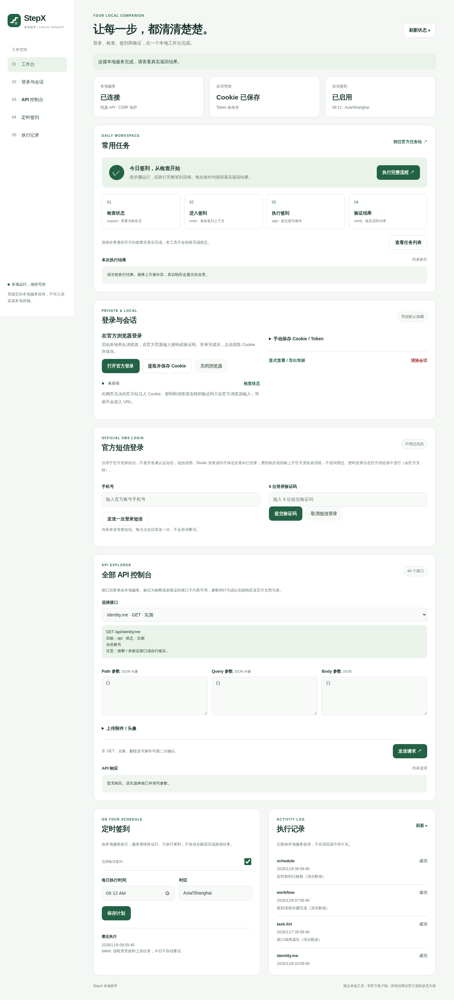

# StepX Toolkit

非官方、**本地优先**的 StepX Studio / A 豆任务中心工具：统一 JavaScript SDK、命令行、本地可视化面板和每日定时签到。适合整理为独立 GitHub 仓库；不依赖当前工作区的移动 App、Supabase 或 DSH。

> 仅操作你本人拥有或明确获授权的账号，遵守官方服务规则。接口来自用户提供的文档和公开前端协议，并非官方稳定 API；文档中的“实测”是**原资料标记**，不是本项目用真实账号完成了验证。不要将 Cookie、token、手机号、验证码提交到 GitHub。



<sub>截图为本项目真实本地界面，使用**合成演示数据**渲染（占位 Cookie、示例执行记录），不含任何真实账号、凭据或个人数据。移动端见 [`docs/images/dashboard-mobile.png`](docs/images/dashboard-mobile.png)。</sub>

## 能力与边界

| 功能 | 实现方式 |
| --- | --- |
| 官方浏览器登录 | 本机打开 `https://m.stepx.com/pages/users/login/index`，你在官方窗口输入账号、验证码，或官方提供的密码登录方式；完成后提取并验证任务网关 Cookie |
| 短信登录 | 按补充的公开前端协议：资格检查 → 公钥信封 → 单次短信 → 加密提交验证码 → 分别验证 Studio 与任务权限 |
| Cookie / token | 导入、状态检查、显式导出和本地清除；Authorization 使用 token 原值，不添加 Bearer |
| 签到 | 检查任务 → 首次进入打点 → POST Sign → 再检查完成与奖励状态；已完成跳过 |
| 其他任务 | 列出官方任务和状态；活跃/设备任务去官方页面实际完成，不伪造活跃、设备或奖励 |
| 全量业务接口 | 44 项：身份/认证、项目、连接器/插件、素材、站内信、模型/音色/头像、附件、余额/流水/礼品/兑换 |
| 定时 | 每日指定 HH:mm + IANA 时区；持久化当天领取标记，失败/崩溃不自动重复提交 |
| 两种入口 | Web 表单/API 控制台 + CLI，使用相同 SDK 和流程 |

**不提供**破解验证码、绕过白名单、批量短信轰炸、密码接口猜测、任意任务强制完成、自动兑换。文档只确认短信登录，密码只能在官方页面确实提供时使用。短信登录成功不代表任务网关一定授权；只有任务验证通过才保存新 Cookie。登录 SMS 与 `developer.sendSmsCode`（开发者认证短信）不是同一接口。

## 接口功能一览（44 项）

下表由 `src/endpoints.js` 自动生成（`npm run docs:api`），CLI、Web 控制台与 SDK 使用同一份目录，构建时会检查表格是否与目录一致，减少文档遗漏。

- **状态**沿用原资料标记：`实测` = 原资料真实调用验证过；`实测（接口存在）` / `实测（代码确认）` = 原资料只确认接口或代码；`代码确认` / `代码确认 method` = 仅从前端代码确认方法与路径；`推断` = method 与入参按前端代码还原，**未经验证，写操作前请自行核对**。
- Studio 类接口路径从 `https://studio-api.stepx.com` 拼接；任务类接口路径从固定网关 `https://otter-gateway.stepaos.com/api/step.otter.zhiyueapp.api` 拼接。
- 标 `POST` / `PATCH` / `DELETE` 的均为写操作，CLI 需 `--yes`，Web 需二次确认。

<!-- API_TABLE_START -->
### 身份与开发者认证

| 接口 | 方法 | 路径 | 作用 | 状态 |
| --- | --- | --- | --- | --- |
| `identity.me` | GET | `/api/identity/me` | 读取当前登录账号资料（userId、昵称、头像、开发者状态等），用于确认 Cookie/token 是否仍然有效。 | 实测 |
| `identity.updateAvatar` | POST | `/api/identity/me/avatar` | 上传并替换当前账号头像，multipart 字段名为 avatar；会覆盖原头像，属于写操作。 | 推断 |
| `developer.status` | GET | `/api/identity/developer/status` | 查询开发者认证状态、当前流程步骤与驳回原因，只读。 | 实测 |
| `developer.profile` | GET | `/api/identity/developer/profile` | 读取已提交的实名/开发者认证资料（真实姓名、脱敏证件号、脱敏手机、邮箱），返回内容含隐私，注意日志脱敏。 | 实测（接口存在） |
| `developer.sendSmsCode` | POST | `/api/identity/developer/sms-code` | 发送「开发者认证」短信验证码，body 形如 {phone}；这不是登录短信，勿与登录流程混用。 | 推断 |
| `developer.submitIdentity` | POST | `/api/identity/developer/identity` | 提交实名/开发者认证资料，字段未实测；涉及真实身份信息，执行前务必核对官方页面请求。 | 推断 |
| `developer.submitReview` | POST | `/api/identity/developer/review` | 提交开发者认证审核，字段未实测；提交后可能进入人工审核流程，不能随意重复提交。 | 推断 |
| `developer.idImage` | GET | `/api/identity/developer/id-images/:imageId` | 按图片 ID 获取证件照地址，需带 biz 业务标识；返回的是敏感材料链接，不要外传。 | 推断 |

### 项目

| 接口 | 方法 | 路径 | 作用 | 状态 |
| --- | --- | --- | --- | --- |
| `projects.list` | GET | `/api/projects` | 列出当前账号的项目，可附加查询条件过滤；项目较多时结果体较大。 | 实测 |
| `projects.get` | GET | `/api/projects/:id` | 按项目 ID 读取单个项目详情。 | 实测 |
| `projects.activity` | GET | `/api/projects/activity` | 读取项目的活跃/未读状态（构建状态、需关注原因、未读结果），用于判断是否有新产出。 | 实测 |
| `projects.publishedPlugins` | GET | `/api/projects/published-plugins` | 列出已发布为插件的项目。 | 实测（接口存在） |
| `projects.create` | POST | `/api/projects` | 新建项目，body 结构未实测；会占用账号项目配额。 | 推断 |
| `projects.update` | PATCH | `/api/projects/:id` | 修改项目（名称、配置等），body 结构未实测；只传需要变更的字段，避免覆盖其他配置。 | 推断 |
| `projects.remove` | DELETE | `/api/projects/:id` | 按项目 ID 请求删除项目；资料未明确恢复及关联数据处理规则，执行前务必备份并二次确认。 | 推断 |
| `projects.builderConfig` | GET | `/api/projects/:id/builder-config` | 读取项目的构建配置（启用的连接器、插件等），只读。 | 实测（代码确认） |
| `projects.updateBuilderConfig` | PATCH | `/api/projects/:id/builder-config` | 更新项目构建配置，方法为 PATCH，入参结构未实测；改动会影响后续构建。 | 代码确认 method |
| `projects.dependencies` | GET | `/api/projects/:id/builder-dependencies` | 读取项目的依赖变更信息（新增/变更的插件与连接器），只读。 | 实测（代码确认） |
| `projects.generateIcon` | POST | `/api/projects/generate-icon` | 调用 AI 为项目生成图标，body 未实测；可能消耗额度。 | 推断 |
| `projects.generateName` | POST | `/api/projects/generate-name` | 调用 AI 为项目生成名称，body 未实测；可能消耗额度。 | 推断 |
| `projects.rebindAttachments` | POST | `/api/projects/:id/attachments/rebind` | 把附件重新绑定到指定项目（原 SDK 缺失的接口），body 未实测；写操作。 | 推断 |

### 连接器与插件

| 接口 | 方法 | 路径 | 作用 | 状态 |
| --- | --- | --- | --- | --- |
| `integrate.connectors` | GET | `/api/integrate/connectors` | 浏览连接器目录，可按 tab、builderType、mine、q 过滤；只读。 | 实测 |
| `integrate.plugins` | GET | `/api/integrate/plugins` | 浏览插件/技能目录，scope=discover 为发现页，mine=true 只看自己接入的；只读。 | 实测 |
| `integrate.disconnect` | DELETE | `/api/integrate/connections/:connectionId` | 取消某个连接器授权，可能影响依赖它的项目构建，不可撤销需重新授权。 | 代码确认 |

### 素材库

| 接口 | 方法 | 路径 | 作用 | 状态 |
| --- | --- | --- | --- | --- |
| `kit.list` | GET | `/api/kit/items` | 分页列出素材/模板。kind 目前仅 template 可用，page 从 1 开始，page_size 必填，否则返回 CORE_KIT_BAD_KIND 或参数错误。 | 实测 |
| `kit.detail` | GET | `/api/kit/items/:kind/:name` | 按 kind + name 读取单个素材/模板详情。 | 代码确认 |
| `kit.recommendations` | GET | `/api/kit/items/:kind/:name/recommendations` | 读取某素材的推荐列表，limit 默认 3。 | 代码确认 |
| `kit.thumbnail` | GET | `/api/kit/items/:kind/:name/thumbnail` | 读取素材缩略图，可能返回图片二进制（原 SDK 缺失的接口）；SDK 会转成 {contentType, base64} 以便 JSON 传输。 | 代码确认 |

### 站内信

| 接口 | 方法 | 路径 | 作用 | 状态 |
| --- | --- | --- | --- | --- |
| `inbox.list` | GET | `/api/inbox` | 分页读取站内信与未读数，cursor 用于翻页；只读。 | 实测 |
| `inbox.read` | PATCH | `/api/inbox/:id/read` | 把单条站内信标记为已读，写操作但影响很小。 | 代码确认 |
| `inbox.readAll` | PATCH | `/api/inbox/read-all` | 把全部站内信标记为已读，一次性影响所有未读消息。 | 代码确认 |

### 模型、音色与附件

| 接口 | 方法 | 路径 | 作用 | 状态 |
| --- | --- | --- | --- | --- |
| `models.chat` | GET | `/api/chat-models` | 列出对话可用模型（含 isDefault 标记）。 | 实测 |
| `models.builder` | GET | `/api/builder-models` | 列出构建流程可选模型。 | 实测 |
| `models.voices` | GET | `/api/builder-voices` | 列出可用音色。 | 实测 |
| `models.avatars` | GET | `/api/builder-avatars` | 列出可用的头像素材。 | 代码确认 |
| `attachments.upload` | POST | `/api/attachments` | 上传附件，multipart 字段名为 file，返回附件引用供项目/聊天使用；会占用账号存储。 | 代码确认 |

### A 豆 / 任务中心

| 接口 | 方法 | 路径 | 作用 | 状态 |
| --- | --- | --- | --- | --- |
| `task.getBalance` | GET | `/GetBalance` | 读取 A 豆余额，返回解包后的 {balance}；也是本项目校验任务域凭据是否有效的探针。 | 实测 |
| `task.list` | GET | `/GetTaskList` | 读取任务列表与完成/奖励状态。task_type：1 每日签到、2 活跃任务、3 设备权益；period_type：0 日、2 周/周期。 | 实测 |
| `task.sign` | POST | `/Sign` | 每日签到，必须 POST 空 JSON {}（原示例 SDK 误用 GET，本项目已修正）；是否重复签到由服务端判定。 | 代码确认 |
| `task.journal` | GET | `/GetPointsJournal` | 分页读取豆子收支流水，type 1 为收入、2 为支出，配合 offset/limit 翻页。 | 实测 |
| `task.gifts` | GET | `/GetGiftList` | 列出可兑换礼品、所需豆子、限购与已兑数量。 | 实测 |
| `task.redeemOrders` | GET | `/GetRedeemOrderList` | 列出历史兑换记录。 | 实测 |
| `task.redeem` | POST | `/Redeem` | 用豆子兑换礼品，body {gift_id}；会扣豆且通常不可撤销，本项目不会在签到或定时流程中调用。 | 推断 |
| `task.firstEnter` | POST | `/FirstEnter` | 提交任务页「首次进入」打点；签到完整流程会调用，但资料未确认它是否直接增加任务进度或奖励。 | 代码确认 |
<!-- API_TABLE_END -->

完整签名、错误码与调用契约见 [`docs/API.md`](docs/API.md)。

## 1. 快速启动

要求 **Node.js 22+、npm**；浏览器登录需要本机桌面环境。Windows/macOS/Linux 均可运行核心功能，文件权限 0600/0700 在 POSIX 有效，Windows 需自行限制目录 ACL。

```bash
cd stepx-toolkit
npm ci
npm run browser:install  # 使用官方浏览器登录时安装 Chromium；短信/导入方式可跳过
npm start
```

打开 **http://127.0.0.1:3210**。这是独立项目的本地页面，不会替换 DSH 页面或外层 App。必须使用 `127.0.0.1`，不要用其他域名或 `localhost`（Host 校验有意限制）。端口冲突时：

```bash
npm run cli -- serve --port 3211
```

面板包含：登录与凭据、签到分步执行、完整 API 控制台、每日定时和执行记录。没有真实数据时显示空态，不内置演示账号。

### 方式 A：官方浏览器（推荐兼容路径）

1. 点击“打开官方登录”，在独立 Chromium 窗口打开 `https://m.stepx.com/pages/users/login/index`。登录在你本机的官方窗口进行，不是在当前网页中嵌入官方站点。任务中心仍为 `https://task.stepaos.com`；更改登录入口不代表移动站会话自动适用于任务网关，保存前仍需验证。
2. 完成官方登录以及任何人工验证码。不要将密码输入本地面板。
3. 回到面板点击“提取并保存 Cookie”。只提取浏览器实际会发送到任务网关的 Cookie，校验余额接口成功后才保存。
4. 若任务网关没有 DSESSIONID，说明会话未建立或域不匹配。继续在官方任务页完成登录，或使用你自己的有效 Cookie/token 导入。Studio Cookie 不保证适用于任务网关。
5. 提取结束关闭独立浏览器；凭据仍保存在本机，直到清除或失效。

无桌面的服务器无法弹出有头浏览器，请在有桌面的电脑登录后通过安全方式导入凭据，或使用短信路径。不要关闭 TLS 校验，也不要为了运行浏览器暴露调试端口。

### 方式 B：短信登录

面板填写本人手机号 → 确认发送一次短信 → 填写 6 位验证码 → 提交。风控业务码 `405002/405003` 立即停止，改用官方浏览器完成人工验证。会话保留内存最多 10 分钟，不落盘手机号/验证码/加密私钥，不自动重试短信或登录。

```bash
npm run cli -- login --sms
# 先只检查公钥协议，不发送短信、不登录：
npm run cli -- login --check
```

协议快照依据用户补充脚本（2026-11-06），包括 HMAC 公钥获取、RSA-OAEP-SHA256 与 AES-256-GCM 信封。源码中的签名配置是官方前端发布的公共配置，**不是服务端私密密钥，也不是你的账号凭据**。官方协议改动时可能失效，届时使用浏览器路径，不尝试绕过风控。任务验证失败不覆盖已有本地凭据。

### 方式 C：导入你自己的凭据

面板粘贴完整 Cookie 或 access_token；保存只是存储，实际有效性需查询余额/任务确认。Cookie 应包含服务端会话和必要的风控票据，不能只复制 DSESSIONID。

CLI 创建一个只放在本机、限制访问权限的文件，例如 `./local-secret.json`：

```json
{ "cookie": "从本人官方会话复制的完整 Cookie", "token": "" }
```

```bash
npm run cli -- auth import --file ./local-secret.json
npm run cli -- auth status
npm run cli -- auth verify
# 显式导出，目标文件必须不存在（禁止覆写/跟随已有符号链接）
npm run cli -- auth export --file ./local-secret-export.json
npm run cli -- auth clear
```

Cookie/token 也可由 `STEPX_COOKIE` / `STEPX_TOKEN` 环境变量注入，**环境变量优先于磁盘**。已设置时需先移除环境变量才能清除实际生效会话。不要把凭据放 CLI 参数、URL、截图或工单。CLI 查询的业务返回可能包含私人数据，重定向日志时请自行保护。

## 2. 分步签到与完整流程

```bash
# 1：读取余额、任务、需手动完成的其他任务
npm run cli -- workflow inspect
# 2：首次进入任务页打点（写操作需 --yes）
npm run cli -- workflow enter --yes
# 3：签到前先检查是否已完成，提交后再次核验
npm run cli -- workflow sign --yes
# 4：只读查看完成与奖励状态
npm run cli -- workflow verify
# 或顺序执行 inspect → enter → sign → verify
npm run cli -- workflow all --yes
```

`Sign` 正确请求是 **POST `{}`**，已修正原始示例 SDK 的 GET 问题。已完成且奖励到账会跳过；列表结构未知、找不到签到任务、请求后未确认完成/奖励时会停止，不宣称成功，不自动重试写操作。重复请求或网络超时后先 `inspect`，避免不确定状态下再次提交。

活跃任务、设备权益等请打开 [官方任务中心](https://task.stepaos.com) 按实际要求完成。资料没有通用“完成指定任务”API，本工具不会虚构它。兑换礼品通过 `task.redeem`，属于推断接口且会消耗积分，必须单独明确确认，不进入签到或调度流程。

## 3. SDK / 全部 API / 上传

```js
import { createClientFromEnv } from './src/sdk.js';

const sx = createClientFromEnv();
console.log(await sx.identity.me());
console.log(await sx.task.getBalance()); // { balance: '...' }，task 信封已解包
console.log(await sx.task.list());
console.log(await sx.projects.list());
console.log(await sx.kit.list()); // kind=template, page=1, page_size=20

// 通用调用可传 path / query / body / files / signal
const project = await sx.call('projects.get', { path: { id: 'YOUR_PROJECT_ID' } });
// 新增补齐：sx.projects.rebindAttachments(id, body)
// 新增补齐：sx.kit.thumbnail(kind, name, tag) -> JSON 或 {contentType, base64}
```

```bash
npm run cli -- endpoints
npm run cli -- call task.getBalance
npm run cli -- call task.journal --args '{"query":{"type":1,"offset":0,"limit":20}}'
npm run cli -- call projects.get --args '{"path":{"id":"YOUR_PROJECT_ID"}}'
npm run cli -- call attachments.upload --file ./image.png --field file --yes
npm run cli -- call identity.updateAvatar --file ./avatar.png --field avatar --yes
# 消耗积分的推断接口，请先核对礼品与真实 body，再自行执行：
# npm run cli -- call task.redeem --args '{"body":{"gift_id":"YOUR_GIFT_ID"}}' --yes
```

PowerShell 的 JSON 引号转义可能不同，复杂调用推荐使用 SDK 脚本。Web API 控制台为全部 44 项提供接口选择、路径/查询/正文 JSON 与本地文件上传，非 GET 需二次确认。标为“推断/代码确认”的写操作只是适配了文档协议，**不代表已在你的账号上验证**；执行前按官方页面网络请求核对入参。

完整矩阵、分组签名、错误码见 [`docs/API.md`](docs/API.md)。SDK 提供类型声明，Node ESM 使用，无须编译。默认每客户端请求起始间隔 300ms、超时 30 秒（包含响应正文读取）、不跟随重定向，不对写请求自动重试。任务信封仅接受数字 `0` / `200` 并返回 `data`，错误不携带原始上游正文或凭据。

## 4. 定时任务

### 内置每日调度（Web / CLI 二选一）

```bash
npm run cli -- schedule set --time 09:00 --timezone Asia/Shanghai
npm run cli -- schedule show
# 保持 npm start 常驻，或者：
npm run cli -- schedule run
# 停用
npm run cli -- schedule disable
```

- 每 30 秒检查一次，以指定 IANA 时区计算日期。仅执行完整签到流程，不兑换、不自动发短信。
- 当天时间已过、当天还没领取执行标记：启动后补执行**当天一次**，不补历史日期。
- **发请求前**先落盘当天标记，失败/进程崩溃后当天不自动重试；请核验真实状态后手动执行。
- 同一数据目录只允许一个 Web 或 CLI 常驻调度进程，签到流程另有锁防止跨进程并发。
- 关机/休眠、进程退出或 Cookie 过期无法执行；“已启用”不是后台云任务。
- 修改时间/时区不重置当天执行标记，防止同一天重复；跨时区日期语义不同，谨慎更换。

### 系统 cron / systemd

不使用内置调度时，可由系统每日运行完整流程（不要同时启用内置计划）：

```cron
# 示例：主机系统时区为 Asia/Shanghai；替换绝对路径
0 9 * * * cd /ABSOLUTE/PATH/stepx-toolkit && /ABSOLUTE/PATH/node bin/stepx.js workflow all --yes >> /PRIVATE/PATH/stepx.log 2>&1
```

cron 无桌面，先完成登录保存 Cookie。Node 绝对路径可由 `command -v node` 查询；保护日志权限并定期清理。更多常驻说明见 [`docs/OPERATIONS.md`](docs/OPERATIONS.md)。

## 5. 本地配置、安全与目录

默认数据：`~/.stepx-toolkit/`，可用 `STEPX_HOME` 指定。包含 `session.json`（敏感、0600）、`schedule.json`、`history.json`（最近 200 条摘要）和运行锁。POSIX 数据目录 0700，写入使用临时文件+原子替换。**不是加密保险箱**：本机同一用户、管理员、备份工具仍可能读取，请启用磁盘加密并保护设备。

| 变量 | 说明 |
| --- | --- |
| STEPX_HOME | 本地数据目录，不要置于 Git 仓库 |
| STEPX_COOKIE / STEPX_TOKEN | 覆盖磁盘会话；token 原样发送 |
| STEPX_API_ORIGIN | 默认 https://studio-api.stepx.com |
| STEPX_TASK_ORIGIN | 默认 https://otter-gateway.stepaos.com/api/step.otter.zhiyueapp.api |
| STEPX_TIMEOUT / STEPX_MIN_INTERVAL | SDK `createClientFromEnv()` 的超时/节流毫秒；Web/CLI 业务使用默认值 |

SDK 允许显式 HTTPS 自定义服务或 loopback HTTP（用于测试）；**自定义域会收到你提供的凭据**，不要使用不可信地址。短信协议只访问固定官方 HTTPS 白名单域。官方浏览器导出的任务 Cookie 与 Studio 跨域不同，若需要 Studio 接口请单独提供有该域权限的凭据。

Web 后端仅监听 loopback，校验 Host、Origin、Fetch Metadata、CSRF，禁止跨域 CORS，响应 no-store/CSP。前端不存 localStorage，不注入第三方脚本，凭据仅通过显式按钮显示 60 秒。该服务面向可信本机单用户，不是多租户管理平台：不要代理到公网、不要监听 0.0.0.0、不要把本地面板嵌入不可信页面。API 结果可能含项目/身份隐私，分享前手工脱敏。清除本地会话不等于官方注销，要使远程凭据失效请在官方账号中退出。

```text
stepx-toolkit/
├── bin/stepx.js           CLI 入口
├── src/
│   ├── endpoints.js       44 项接口声明与原资料验证状态
│   ├── sdk.js / sdk.d.ts  统一 SDK 与声明
│   ├── http-session.js    域/path/secure Cookie jar、安全重定向
│   ├── sms-login.js       短信加密协议与鉴权检查
│   ├── login.js           官方有头浏览器提取
│   ├── workflow.js        分步签到与奖励核验
│   ├── scheduler.js       每日调度和执行标记
│   ├── store.js           私有本地存储与锁
│   └── server.js          仅本地 HTTP API
├── web/                  不依赖 CDN 的原生可视化界面
├── test/                 SDK / 登录 / 流程 / 调度 / HTTP 安全测试
├── scripts/              构建校验、界面冒烟与截图脚本
├── examples/             SDK 与 systemd 示例
├── docs/                 API、运维、需求映射、验证记录与界面截图
└── .github/              CI、Issue / PR 模板
```

## 6. 开发与验证

```bash
npm ci
npm test
npm run typecheck
npm run build
# 可选：本地浏览器冒烟测试（需安装 Chromium）
node scripts/smoke-ui.mjs
# 重新生成 README 截图（使用临时目录与合成演示数据，不访问官方接口）
node scripts/screenshot.mjs
# 若环境已有其他版本 Chromium，可通过 STEPX_TEST_CHROMIUM 指定绝对路径
```

测试使用 mock 与 localhost HTTP；不发送真实短信、不登录真实账号、不消耗积分。`typecheck` 校验类型声明/模块解析，JavaScript 当前不启用全量 `checkJs`，不应误称为完整静态类型保证。`build` 检查 JavaScript 语法、44 项接口目录完整性，并复制本地资源到 `dist/web/`；运行时直接服务 `web/`，**dist 不是可脱离 Node 后端部署的静态站点**。

真实登录、风控通过率、官方当天签到、推断写接口需要你在本机用自己的账号验收。测试通过不能替代这一步。问题排查见 [`docs/OPERATIONS.md`](docs/OPERATIONS.md)。

## 7. 发布到 GitHub

本目录是独立仓库根，不包含外层工程。可以先本地检查，再发布到你自己的 GitHub：

```bash
cd stepx-toolkit
git init
git add .
git diff --cached --stat
# 仔细核对：无 .env、凭据、数据目录、node_modules、dist、截图中的个人信息
git commit -m "feat: add local StepX SDK CLI dashboard and scheduler"
# 先在 GitHub 创建空仓库，再替换为真实远端：
git branch -M main
git remote add origin https://github.com/YOUR_NAME/stepx-toolkit.git
git push -u origin main
```

也可使用已认证的 `gh repo create`。本次交付不会假称已创建远端仓库，也不会未经授权上传账号资料。`private: true` 仅阻止误发布 npm，不影响 GitHub 开源；若计划发布 npm 包，请先补正式仓库字段、版本策略、许可证审查与发布流程，再移除此标记。

## 来源与许可

原创实现使用 [MIT](LICENSE)。StepX 名称/商标归原权利人所有，本项目不代表官方。

接口依据用户给出的 [接口文档](https://static.919900755.xyz/view/StepX%20%E6%8E%A5%E5%8F%A3%E6%96%87%E6%A1%A3.md)、[原 SDK](https://static.919900755.xyz/view/StepX%20%E7%BB%9F%E4%B8%80%E6%8E%A5%E5%8F%A3%20SDK.js) 与用户补充短信协议。`docs/reference/` 为对照资料，**上游未附授权，MIT 不覆盖这些参考资料**。公开分发前请取得许可；仓库默认不跟踪参考原件，只跟踪出处说明。实现独立重写，保留接口契约与状态标注，不将上游源码直接作为本项目源码发布。
